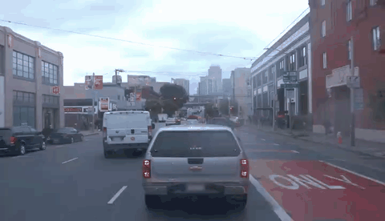

# StreetNVS: Effective Multi-sensor Conditioning for Street-view Novel-view Synthesis

<p align="center">
  <a href="https://zhengfeikuang.com/">Zhengfei Kuang</a><sup>1</sup> ·
  <a href="https://adamsunn.github.io/">Adam Sun</a><sup>1</sup> ·
  <a href="https://www.zhuliyuan.net/">Liyuan Zhu</a><sup>1</sup> ·
  <a href="https://wutong16.github.io/">Tong Wu</a><sup>1</sup> ·
  <a href="https://primecai.github.io/">Shengqu Cai</a><sup>1</sup> ·
  <a href="https://research.nvidia.com/person/jonathan-tremblay">Jonathan Tremblay</a><sup>2</sup> ·
  <a href="https://ir0.github.io/">Iro Armeni</a><sup>1</sup> ·
  <a href="https://stanford.edu/~eadeli/">Ehsan Adeli</a><sup>1</sup> ·
  <a href="https://lioryariv.github.io/">Lior Yariv</a><sup>1</sup> ·
  <a href="https://web.stanford.edu/~gordonwz/">Gordon Wetzstein</a><sup>1</sup>
</p>
<p align="center"><sup>1</sup> Stanford University &nbsp;&nbsp; <sup>2</sup> NVIDIA</p>

<p align="center">
  <a href="https://arxiv.org/abs/2606.01590"></a>
  <a href="https://arxiv.org/pdf/2606.01590"></a>
  <a href="https://streetnvs.github.io/website/"></a>
  <a href="https://huggingface.co/zfkuang/StreetNVS"></a>
</p>

This repository is the official implementation of **StreetNVS: [Effective Multi-sensor Conditioning for Street-view Novel-view Synthesis](https://arxiv.org/abs/2606.01590)**.

Modern vehicle platforms are equipped with a rich sensor suite, including LiDAR, calibrated multi-camera rigs, and accurate ego-motion, that in principle offers strong signal for re-rendering a driving scene from novel viewpoints. A growing line of recent work leverages video diffusion models for this task, using their generative priors to synthesize plausible novel views from sparse vehicle observations. In practice, however, existing methods exploit only a fragment of this signal, and their quality tends to degrade as the target trajectory departs from the recorded driving path. We argue that this is fundamentally a multi-sensor fusion problem: sparse LiDAR reprojections supply accurate but incomplete metric geometry, surround-view reference imagery supplies dense appearance but no metric depth, and camera poses tie the two together across views. We introduce StreetNVS, a video diffusion framework that jointly conditions on all three signals through a Reference-Enhanced Camera Attention module based on a relative ray-level positional encoding. We develop a two-stage curriculum training strategy that gradually exposes the model to increasingly sparse LiDAR. On the Waymo Open Dataset, StreetNVS substantially outperforms state-of-the-art baselines under sparse LiDAR conditioning, matches methods that rely on 10–100× denser point clouds. We further show capabilities of synthesizing coherent videos along extreme out-of-trajectory paths such as elevation, lane-shift, pullback, and rotation.

<p align="center">
  <a href="https://streetnvs.github.io/website/"></a>
</p>

## File Structure

```text
StreetNVS/
├── streetnvs/          # Model and inference code, built on DiffSynth-Studio
├── data_processing/   # Waymo preparation scripts and their README
├── scripts/           # Environment setup and checkpoint download
├── assets/            # Result videos and animated previews
├── models/            # Downloaded weights
├── data/              # Your raw data and prepared inference inputs
└── outputs/           # Generated videos
```

`models/`, `data/`, and `outputs/` are created as you follow the steps below.

## Environment Setup

We recommend **Python 3.11, PyTorch 2.9.1, CUDA 12.8, and an Nvidia GPU with BF16 support and at least 64 GB of GPU memory** for the 81-frame example below. We use **Nvidia H100 80 GB GPUs**. To set up the environment on Linux, run:

```bash
git clone https://github.com/StreetNVS/StreetNVS.git
cd StreetNVS
bash scripts/setup.sh
source scripts/env.sh
source .venv/bin/activate
```

The setup script installs DiffSynth-Studio and our dependencies in a uv/venv environment. It keeps caches and temporary files in `.runtime/` inside the repository. Run the two `source` commands again when you open a new terminal.

## Download Checkpoints

Run the following to download our [StreetNVS checkpoint](https://huggingface.co/zfkuang/StreetNVS), along with the text encoder, VAE, and tokenizer from Wan2.2:

```bash
python scripts/download_models.py --output models
```

The weights are public and can be downloaded without logging in. They will be saved here:

```text
models/
├── Wan2.2-TI2V-5B/       # Text encoder, VAE, and tokenizer
└── StreetNVS/
    └── streetnvs.safetensors
```

`streetnvs.safetensors` contains the complete StreetNVS diffusion model and loads in one step.

## Data Preparation

Please follow [data_processing/README.md](data_processing/README.md) to prepare a Waymo scene. The guide walks through downloading the raw data, extracting cameras and LiDAR, and rendering the inputs for inference.

The examples below use scene 010. Prepare the recorded front camera (`0`) in `data/scene010_cam0/`, and the novel camera paths (`bev` and `lane_shift_extreme`) in `data/scene010/`. The guide provides complete commands for both. You can change the point sampling ratio to `0.1`, `0.01`, or `0.001` when rendering.

You will need your own [Waymo Open Dataset](https://waymo.com/open/) access. We do not include Waymo data in this repository.

## Inference

### 1. Front Camera (Camera 0)

Start with the recorded front camera. Follow the [camera 0 preparation commands](data_processing/README.md#front-camera-camera-0), then run:

```bash
python -m streetnvs.infer \
  --models models/Wan2.2-TI2V-5B \
  --checkpoint models/StreetNVS/streetnvs.safetensors \
  --data data/scene010_cam0 --scene 10 --camera 0 \
  --reference-cameras 1 2 3 4 --num-frames 81 \
  --start 0 --steps 20 --cfg 5 --seed 42 \
  --output outputs/scene010_cam0.mp4
```

This follows the recorded front-camera trajectory and uses the first image from each of the other four cameras as a reference. The target camera supplies the initial frame.

### 2. Extreme Novel-view Synthesis

Prepare the [novel camera paths](data_processing/README.md#extreme-novel-views), then generate an extreme lane-shift video:

```bash
python -m streetnvs.infer \
  --models models/Wan2.2-TI2V-5B \
  --checkpoint models/StreetNVS/streetnvs.safetensors \
  --data data/scene010 --scene 10 --camera lane_shift_extreme \
  --reference-cameras 0 1 2 3 4 --num-frames 81 \
  --start 0 --steps 20 --cfg 5 --seed 42 \
  --output outputs/scene010_lane_shift_extreme.mp4
```

Novel trajectories use all five surround-view cameras as references. For bird's-eye view, change `--camera` to `bev` and use `--output outputs/scene010_bev.mp4`.

Both examples save an **832 × 480 video at 10 FPS** and a JSON file containing the settings. Use `--num-frames 49` when your prepared input has 49 frames.

### Inference Parameters

The table lists CLI defaults; the commands above set the values used for scene 010 explicitly.

| Parameter | Default | Purpose |
| --- | --- | --- |
| `--models` | Required | Directory containing the Wan text encoder, VAE, and tokenizer. |
| `--checkpoint` | Required | Path to `streetnvs.safetensors`. |
| `--data` | Required | Prepared input directory containing `metadata_cond.csv`, `camera_data.json`, and the videos. |
| `--scene` | `0` | Scene ID in the metadata; use `10` for scene 010. |
| `--camera` | `2` | Target camera ID or prepared trajectory name; these examples use `0`, `lane_shift_extreme`, or `bev`. |
| `--reference-cameras` | `0 1 2` | Cameras supplying reference images. Use `1 2 3 4` for camera 0 and `0 1 2 3 4` for novel views. The target camera is excluded automatically. |
| `--num-frames` | `49` | Output length: `49` or `81`. Must match the prepared clip length. |
| `--start` | `0` | Selects the clip whose `start_frame` matches this value in the metadata. |
| `--steps` | `20` | Number of denoising steps. More steps take longer. |
| `--cfg` | `5.0` | Text guidance scale. Set to `1` to disable classifier-free guidance. |
| `--seed` | `42` | Random seed for noise initialization. |
| `--output` | Required | Output MP4 path; a JSON file with the same stem records the run settings. |

Camera IDs `0`–`4` are front, front-left, front-right, side-left, and side-right. Point sampling and trajectory shape are set during [data preparation](data_processing/README.md#4-render-and-export).

Run `python -m streetnvs.infer --help` for all options.

### Results

The camera 0 result was generated with the first example above. The BEV and extreme lane-shift videos are from the paper. Results may vary with point sampling and random seed; see the [project page](https://streetnvs.github.io/website/) for more videos and comparisons.

| Front camera (camera 0) | Bird's-eye view | Extreme lane shift |
| :---: | :---: | :---: |
| [](assets/scene010_cam0.mp4) | [](assets/scene010_bev.mp4) | [](assets/scene010_lane_shift_extreme.mp4) |
| [Full video](assets/scene010_cam0.mp4) | [Full video](assets/scene010_bev.mp4) | [Full video](assets/scene010_lane_shift_extreme.mp4) |

## Citation

```bibtex
@article{kuang2026streetnvs,
  title={Effective Multi-sensor Conditioning for Street-view Novel-view Synthesis},
  author={Kuang, Zhengfei and Sun, Adam and Zhu, Liyuan and Wu, Tong and Cai, Shengqu and Tremblay, Jonathan and Armeni, Iro and Adeli, Ehsan and Yariv, Lior and Wetzstein, Gordon},
  journal={arXiv preprint arXiv:2606.01590},
  year={2026}
}
```

## Acknowledgements

We build on [Wan2.2](https://github.com/Wan-Video/Wan2.2), [DiffSynth-Studio](https://github.com/modelscope/DiffSynth-Studio), and PRoPE. Thank you to the authors for sharing their code and models. We also thank Astra for helping prepare this repository.

StreetNVS inference extensions are released under the [Apache License 2.0](LICENSE). Third-party preprocessing and rasterizer components retain their own license terms, including research/non-commercial restrictions; see [NOTICE](NOTICE). Model and dataset licenses remain those of their respective providers.
